# Home Assistant 3D Floor Plan

Add an interactive 3D floor plan to Home Assistant using the free version of NeonPlan 3D. This guide follows the same steps as the video, and each step links to that point in the video.

Watch the video: [How to Add a 3D Floor Plan to Home Assistant (NeonPlan 3D)](https://youtu.be/JfzmJGuAmIo)

Article last updated: 17 November 2026

## Shout-out

This guide uses **NeonPlan 3D**, built by Torsten (**Mastershort**): https://github.com/Mastershort/neonplan3d

- Official manual: https://mastershort.de/en/neonplan3d/manual/?lang=en
- Online demo: https://neonplan3d.mastershort.de/
- Support the developer: https://www.paypal.com/donate/?hosted_button_id=Z3G2VWKSK5VJL

This isn't a complete A to Z guide. The official manual covers everything in detail. This guide sticks to the fundamentals and a few things that caught me out.

## Contents

1. [Install NeonPlan 3D](#step-1-install-neonplan-3d)
2. [Check for updates](#step-2-check-for-updates)
3. [First launch](#step-3-first-launch)
4. [Ways to create your floor plan](#step-4-ways-to-create-your-floor-plan)
5. [Add a floor and import your 2D plan](#step-5-add-a-floor-and-import-your-2d-plan)
6. [Draw the rooms](#step-6-draw-the-rooms)
7. [Name the rooms and assign areas](#step-7-name-the-rooms-and-assign-areas)
8. [Add doors and windows](#step-8-add-doors-and-windows)
9. [Add devices](#step-9-add-devices)
10. [Tip: lock the floor plan](#step-10-tip-lock-the-floor-plan)
11. [Add furniture](#step-11-add-furniture)
12. [Add wall light switches (optional)](#step-12-add-wall-light-switches-optional)
13. [Preview in 3D](#step-13-preview-in-3d)
14. [Add it to your dashboard](#step-14-add-it-to-your-dashboard)

Also covered: [Prerequisites](#prerequisites), [Manual install](#manual-install-docker-or-no-store-access-untested) and [Further reading](#further-reading).

## Prerequisites

- Home Assistant installed and running. Ideally **2026.11 or newer**, which includes the Marketplace. On an older version, you'll install through HACS instead. The steps are almost the same.
- A 2D floor plan of your home (a photo is fine), or your room measurements.
- Optional: smart devices already set up in Home Assistant, so you can control them from the plan.

## Step 1: Install NeonPlan 3D ([▶ 2:42](https://youtu.be/JfzmJGuAmIo?t=162))

1. Open the [installation chapter of the manual](https://mastershort.de/en/neonplan3d/manual/installation/) and click **Open Marketplace repository on My Home Assistant**.

   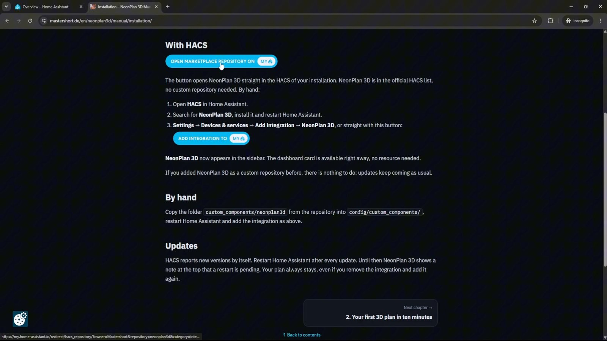

2. Check the Home Assistant URL and click **Save**, then **Open link**. Sign in if asked.
3. On the NeonPlan 3D page in the Marketplace, click **Install** (top right), then **Install** again.
4. Click **Submit** to add it to your sidebar, then **Finish**.

   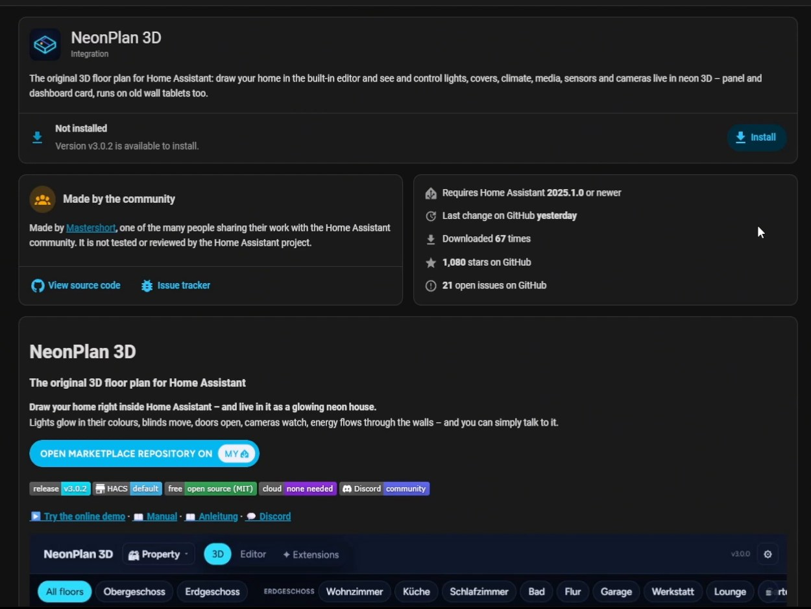

5. Check it's there: go to **Settings → Devices & services** and search for NeonPlan 3D. If it isn't listed, click **Add integration** and search for **NeonPlan 3D**. If you still can't find it, restart Home Assistant and try again.

> **First time opening the Marketplace?** Home Assistant asks you to accept a short disclaimer. Read it, tick that you understand the risks, and click **Continue**. If you skip this, Marketplace updates will fail.
>
> 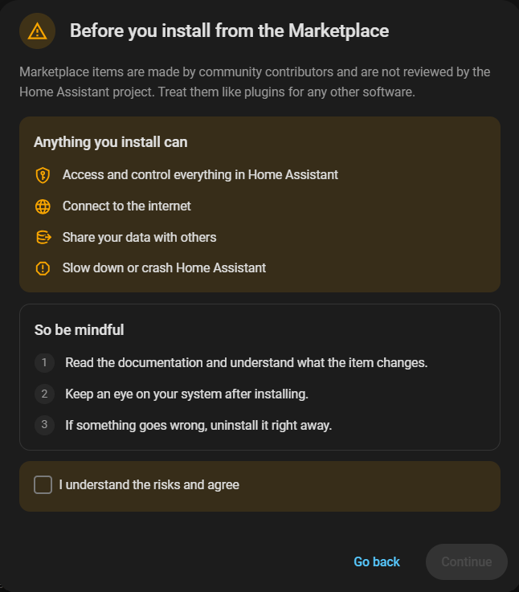

## Step 2: Check for updates ([▶ 5:13](https://youtu.be/JfzmJGuAmIo?t=313))

NeonPlan 3D is updated often, so check for updates straight after installing.

1. Go to **Settings** and click the updates banner.
2. Find **NeonPlan 3D** and click **Update**.
3. Restart Home Assistant if asked.

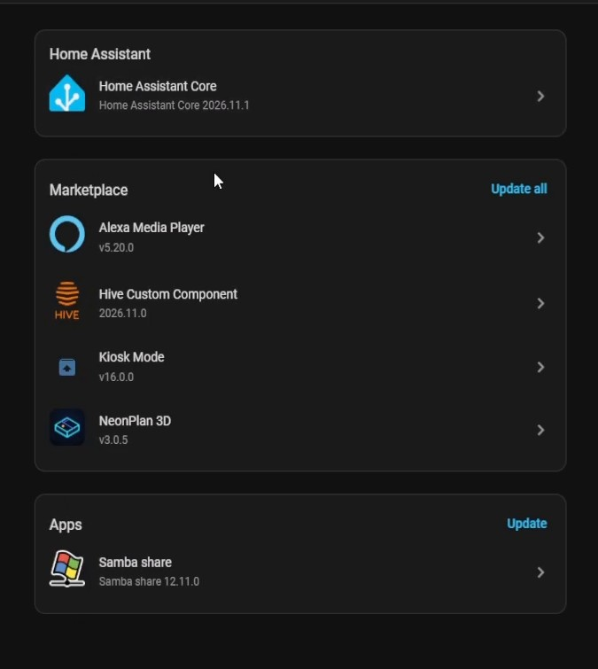

## Step 3: First launch ([▶ 5:46](https://youtu.be/JfzmJGuAmIo?t=346))

Click **NeonPlan 3D** in the sidebar. The first time, a pop-up offers a free account. You only need one for the paid bundles and the free seasonal packs. Choose **Later** to carry on with what's included for free.

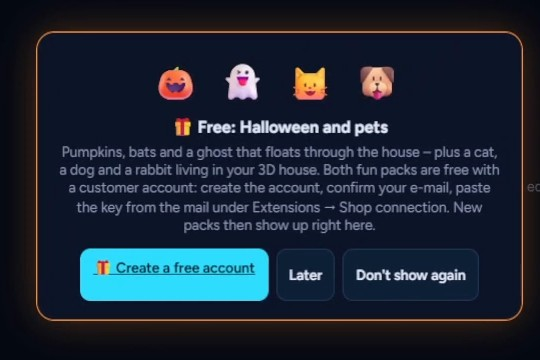

## Step 4: Ways to create your floor plan ([▶ 6:24](https://youtu.be/JfzmJGuAmIo?t=384))

There are a few ways to start:

- **iPhone or iPad with LiDAR:** scan your rooms with a RoomPlan app and import the scan.
- **Sweet Home 3D:** if you've already drawn your home there, import the `.sh3d` file.
- **By hand:** draw it over a photo of your 2D plan, or over a sketch with your own measurements. This is what the guide and video cover.

For the import options, see the [official manual](https://mastershort.de/en/neonplan3d/manual/?lang=en).

## Step 5: Add a floor and import your 2D plan ([▶ 7:16](https://youtu.be/JfzmJGuAmIo?t=436))

1. Switch from **3D** to **Editor** at the top.
2. Click the floor menu and choose **Add floor**. It defaults to **Ground floor**, elevation **0** and a ceiling height of **2.5 m**.

   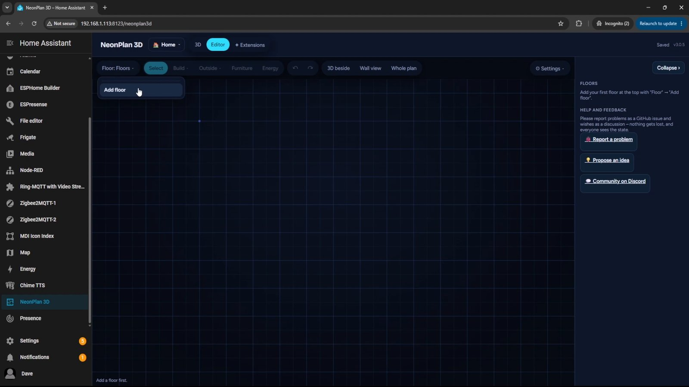

3. Expand **Template** and click **Choose image** to load a photo of your floor plan.
4. Click **Scale with ruler**, click two points you know the distance between, enter that distance and click **Apply scale**.

   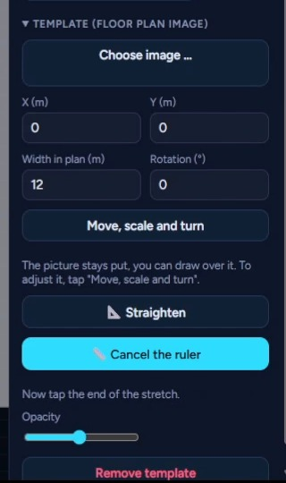

## Step 6: Draw the rooms ([▶ 9:06](https://youtu.be/JfzmJGuAmIo?t=546))

**Draw rooms, not walls.** Drawing the rooms creates the walls automatically, so you don't need the Wall tool.

1. Go to **Build → Room** and choose **Rectangle**, **Free shape** or **By measure**.

   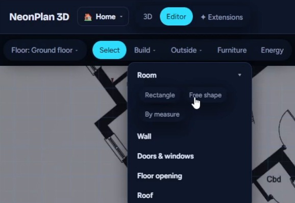

2. Trace each room. With Free shape, finish on the starting point (it shows a circle) so the shape closes cleanly.
3. Drag the corners so neighbouring rooms snap together.
4. **Open-plan rooms:** select a room, scroll down to the wall heights, and set **No wall** on the edges you don't want.

   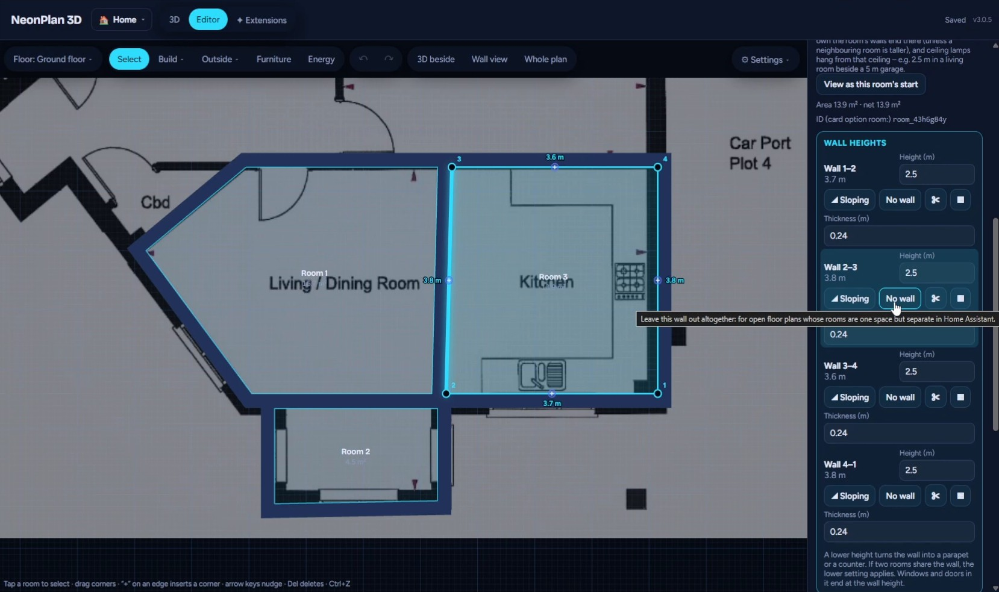

> **Tip:** if a corner won't line up exactly, hold **Alt** while you drag it to place it precisely.

## Step 7: Name the rooms and assign areas ([▶ 14:21](https://youtu.be/JfzmJGuAmIo?t=861))

Select each room and fill in:

- **Name**, for example Lounge.
- **Area**: the matching Home Assistant area.
- **Further names for the voice** (optional): extra names Home Assistant Voice can use for the room.

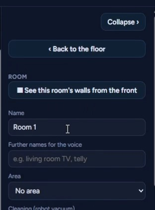

## Step 8: Add doors and windows ([▶ 15:26](https://youtu.be/JfzmJGuAmIo?t=926))

**Doors**

1. Go to **Build → Doors & windows** and click a wall. It starts as a door.
2. If it opens the wrong way, use **Swap hinge side** or **Reverse opening direction**.
3. Choose a **Style** if you like. Most other settings can stay as they are.

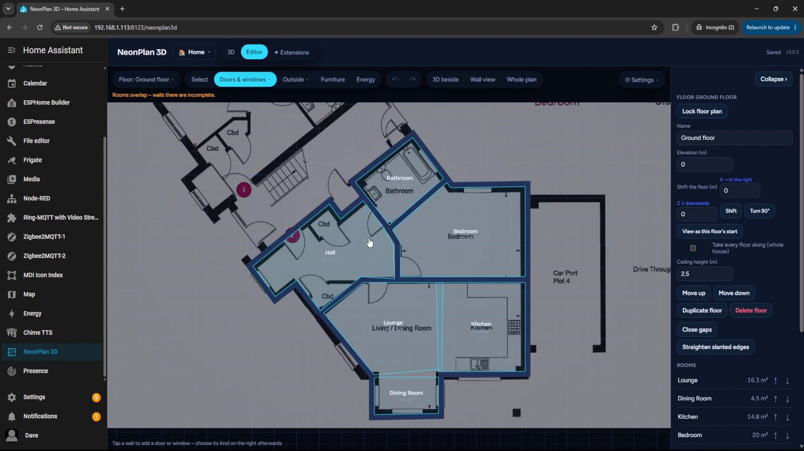

**Windows**

1. Click a wall and pick a window type, such as **Double window**. You can set the width if you know it.
2. Under **Blind**, choose your smart blind. NeonPlan often finds it automatically. You don't need to set which side is outside.

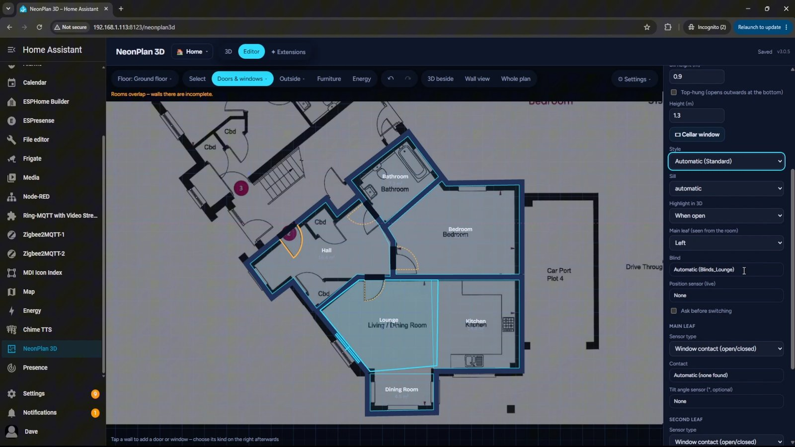

> **Curtains:** the blind field takes one cover. If you only have motorised curtains, pick them there. The animation shows a roller blind, but it still shows open or closed. If a window has a blind and curtains, put the blind there and add the curtains as a separate device beside the window (Step 9).
>
> **Update:** a motorised curtain you can link to Home Assistant is now in the paid **Architecture & Fit-out** pack.

## Step 9: Add devices ([▶ 19:19](https://youtu.be/JfzmJGuAmIo?t=1159))

Devices are your real Home Assistant entities, such as switches, lights, covers and sensors.

1. Click **Select** in the toolbar first. The Devices panel only appears in Select mode.
2. Click a room. The **Devices** panel shows **This area**, **Other areas** and **No area**. If a device is missing, it may not be assigned to an area in Home Assistant, so check **No area**.
3. Find a device and click **Place**, then drag it to where it is in the room. The ☆ adds it to the room panel without placing it.

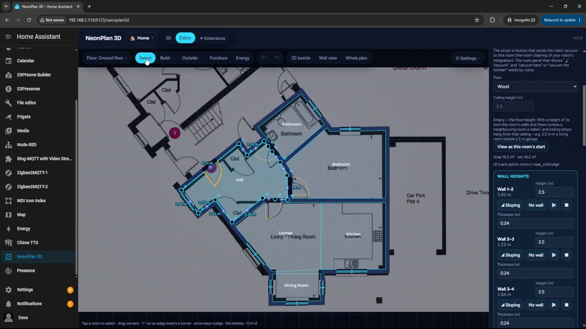

## Step 10: Tip: lock the floor plan ([▶ 23:40](https://youtu.be/JfzmJGuAmIo?t=1420))

When you add and move devices or furniture, it's easy to drag a wall or room by accident. **Undo** only works while you stay in the editor. If you switch to 3D and come back, the undo history is gone.

Click **Lock floor plan** (in the floor panel, or right-click) so walls and rooms stay put.

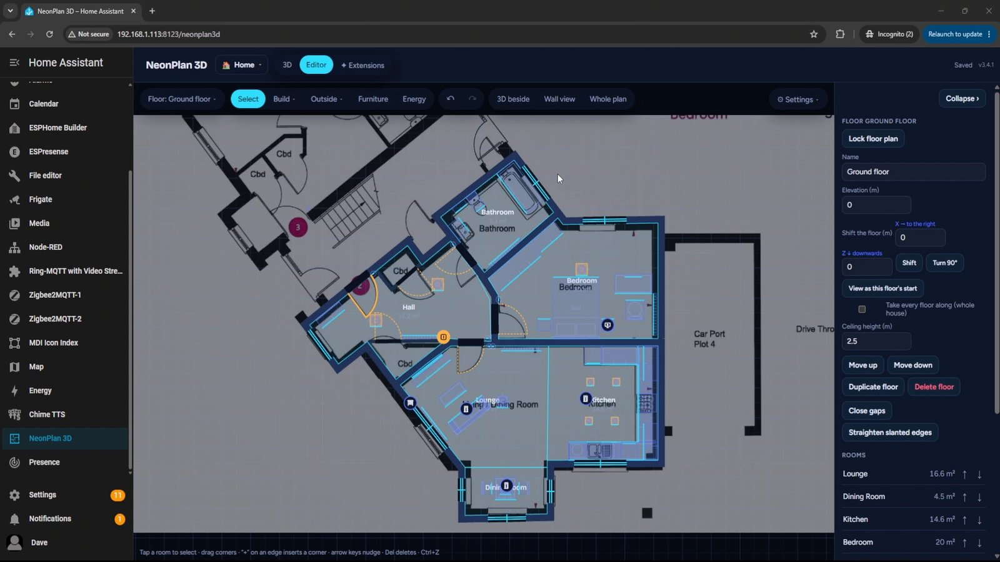

## Step 11: Add furniture ([▶ 24:18](https://youtu.be/JfzmJGuAmIo?t=1458))

1. Click **Furniture** and search, or filter by room. Items with a 🔒 are from paid packs.
2. Items go into the middle of the selected room. Drag them into place, and hold **Alt** to fine-tune the angle.
3. **Lights** are under furniture too. Link a light to its Home Assistant entity so you can tap it in 3D.

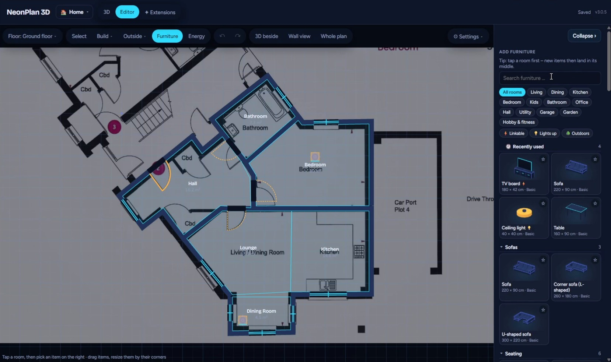

> **Tip:** there are no built-in kitchen units in the free furniture. A table resized to the worktop, with small cupboards underneath, makes a convincing kitchen.

## Step 12: Add wall light switches (optional) ([▶ 29:04](https://youtu.be/JfzmJGuAmIo?t=1744))

As well as clickable lights, you can add a physical switch on the wall:

1. In **Furniture**, search for **light switch**.
2. Place it on the wall and link it to your switch entity.

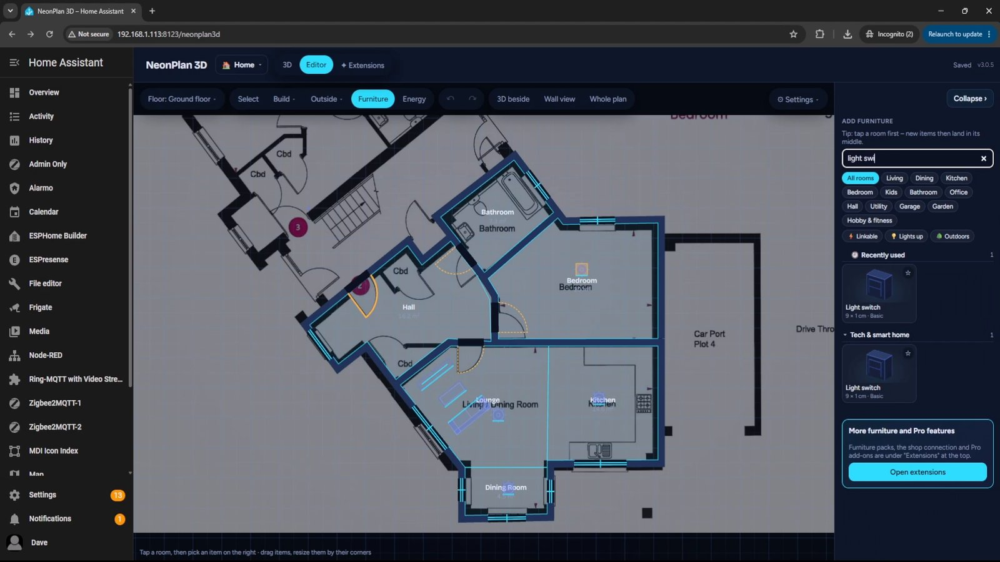

## Step 13: Preview in 3D ([▶ 30:25](https://youtu.be/JfzmJGuAmIo?t=1825))

Switch to **3D** at the top. Tap a light or switch to turn it on and off.

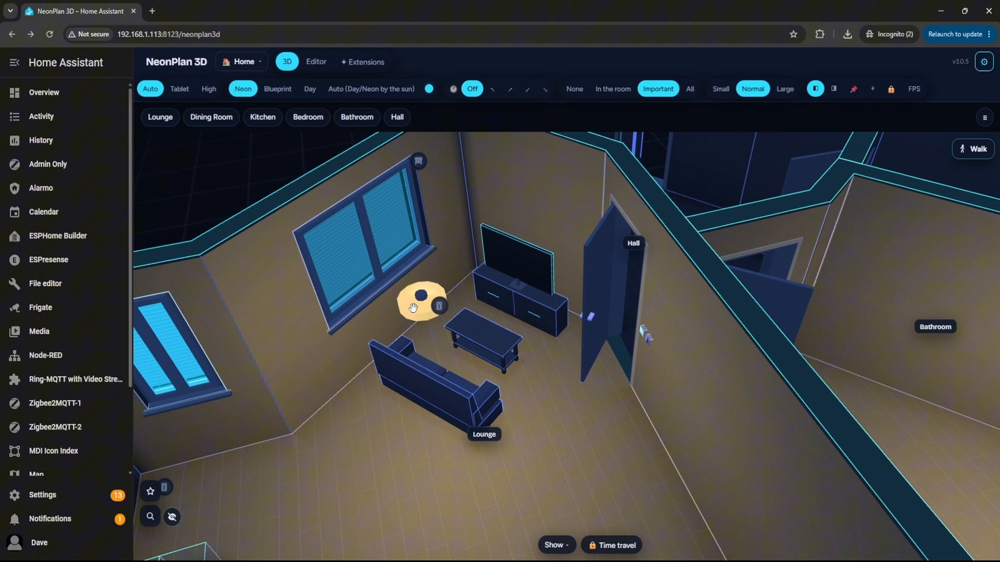

## Step 14: Add it to your dashboard ([▶ 31:24](https://youtu.be/JfzmJGuAmIo?t=1884))

The easiest way is a card template, so you don't need to write YAML.

1. In NeonPlan, go to **Settings → Card templates** and create one. Set the size to fill the screen and pick a style.

   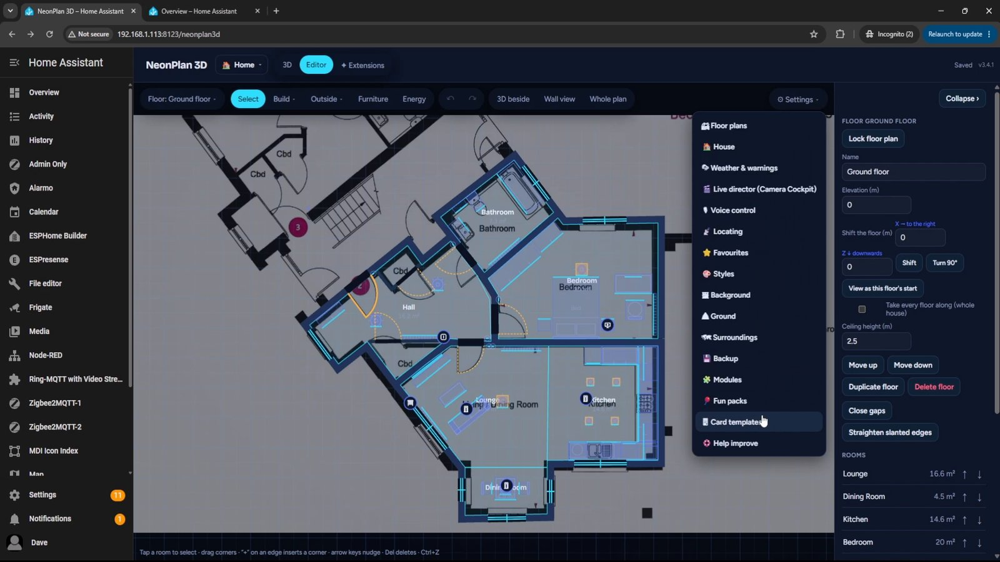

2. In your dashboard, add a new view and choose the **Panel (single card)** layout, so the card fills the screen.

   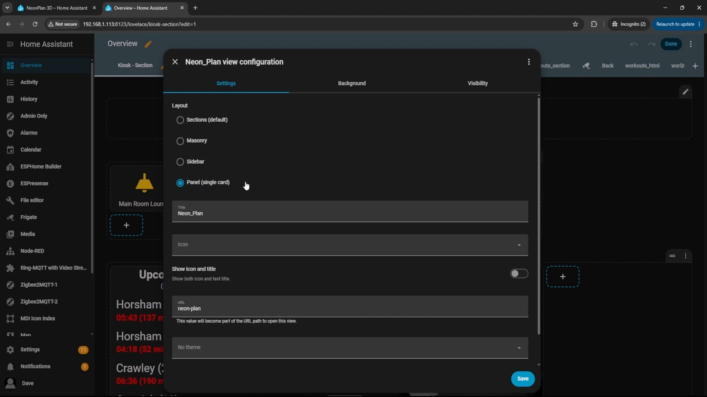

3. Add a card, search for **NeonPlan 3D** and choose your template.
4. Optional: add a home button that goes back to your main dashboard, and a navigation button on your main dashboard that opens the plan.


If you prefer YAML, a card using a template only needs:

```yaml
type: custom:neonplan3d-card
template: YOUR_TEMPLATE_NAME
```

For every card option, see the [dashboard card chapter](https://mastershort.de/en/neonplan3d/manual/dashboard-card/) of the manual.

## Manual install (Docker or no store access) [UNTESTED]

If you can't use the Marketplace or HACS, copy the integration by hand:

1. Download or clone https://github.com/Mastershort/neonplan3d.
2. Copy the `custom_components/neonplan3d` folder (the whole folder).
3. Paste it into `config/custom_components/`, so you end up with `config/custom_components/neonplan3d/`.
4. Restart Home Assistant, then add the integration as in Step 1.

## Further reading

- [Wall tablet](https://mastershort.de/en/neonplan3d/manual/wall-tablet/)
- [Backup and moving](https://mastershort.de/en/neonplan3d/manual/backup-and-moving/)
- [Full manual](https://mastershort.de/en/neonplan3d/manual/?lang=en)
