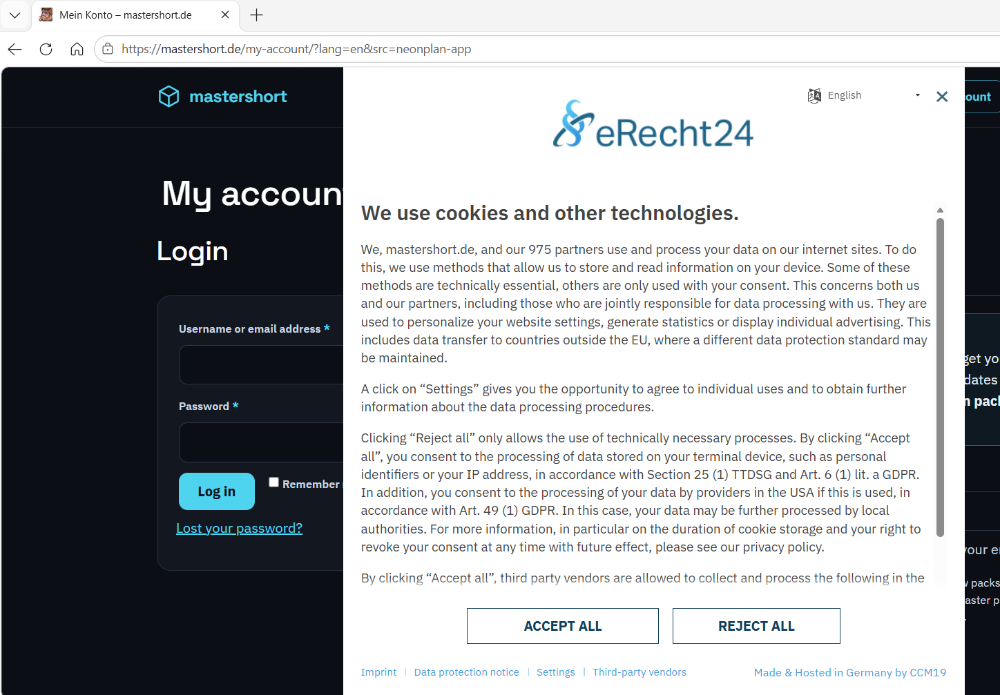

# HomeAssistant-3D-Floor-Plan

**Watch the full video:** [How to Add a 3D Floor Plan to Home Assistant (NeonPlan 3D)](VIDEO_URL)

A step-by-step guide to adding a 3D floor plan to your Home Assistant dashboard, using the **NeonPlan 3D** integration by Mastershort. Each step links to the matching point in the video.

**Shout-out:** This guide features **NeonPlan 3D**, created by **Mastershort**. Original project: https://github.com/Mastershort/neonplan3d

To support Mastershort's future projects, you can donate here: https://www.paypal.com/donate/?hosted_button_id=Z3G2VWKSK5VJL

> **Status:** Draft. Written while Home Assistant 2026.11 (which adds the Marketplace) is still being released. Steps may change once it's out.

## Prerequisites

- Home Assistant **2025.1 or newer**.
- Access to your Home Assistant config folder, if you use the manual install below.

## Manual install (Docker or no store access) [UNTESTED]

If you can't use the store, for example when running Home Assistant in Docker, copy the integration by hand:

1. Download or clone https://github.com/Mastershort/neonplan3d.
2. Copy the `custom_components/neonplan3d` folder (the whole folder, not individual files).
3. Paste it into `config/custom_components/` in your Home Assistant config directory, so you end up with `config/custom_components/neonplan3d/`.
4. Restart Home Assistant.

## Step 1: Find the install button on the NeonPlan GitHub page ([▶ 00:30](VIDEO_URL&t=30s))

Go to https://github.com/Mastershort/neonplan3d and find the button that opens the integration in the Home Assistant store. The wording on the button is "Open your Home Assistant instance and open the NeonPlan 3D repository inside HACS" (or similar, depending on the version).

## Step 2: Open the Marketplace ([▶ 01:00](VIDEO_URL&t=60s))

Clicking the button takes you to your Home Assistant Marketplace (previously called HACS, or "Hacks").

## Step 3: Download the integration ([▶ 01:30](VIDEO_URL&t=90s))

1. Find NeonPlan 3D in the list.
2. Click the three dots (⋮) in the top corner.
3. Select **Download**.
4. Wait for the download to finish.

## Step 4: Restart Home Assistant ([▶ 02:00](VIDEO_URL&t=120s))

When the download finishes, Home Assistant shows a **pending restart** notification. Restart Home Assistant to finish installing the integration.

## Step 5: Add the integration ([▶ 03:00](VIDEO_URL&t=180s))

1. Go to **Settings → Devices & services → Add integration**.
2. Search for **NeonPlan 3D** and select it.
3. A pop-up appears saying the integration will be added to your dashboard. Click **Submit**.
4. You're taken to the integration page. Go back to the main Home Assistant page and you'll see **NeonPlan 3D** in the sidebar.

## Step 6: Open the panel and draw your floor plan [UNTESTED] ([▶ 04:00](VIDEO_URL&t=240s))

1. Click **NeonPlan 3D** in the sidebar.
2. Switch to the **Editor** tab.
3. Draw your first floor, or import an existing plan. The 3D view appears beside the plan as you draw.

## Step 7: Add the 3D card to your dashboard (optional) [UNTESTED] ([▶ 06:00](VIDEO_URL&t=360s))

1. Add a card of type `custom:neonplan3d-card`, using the visual editor or YAML.
2. You don't need to add it as a resource. The card loads automatically.
3. Options such as `floor` and `height` are optional.

## First run: one-time prompts [UNTESTED]

The first time you open NeonPlan 3D from the sidebar, a pop-up offers free Halloween and pets packs. To get them, you need a free customer account. You can choose **Later** to skip it, or **Don't show again** to hide the pop-up. The floor plan works without an account.

> **Note:** Once you've completed the first-run prompts, they don't appear again. If you want to see them again, you'll need to uninstall and reinstall the integration.

### Optional: Create a free account [UNTESTED]

Only needed if you want the free packs. Click **Create a free account**, which opens the NeonPlan account page. You may see a cookie consent banner first. Accept or reject it as you prefer, then continue with the sign-up.

