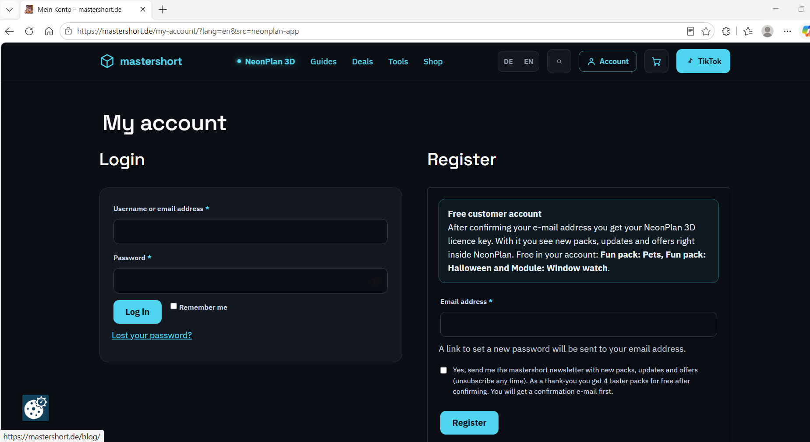

# Home Assistant 3D Floor Plan

Add a 3D floor plan to your Home Assistant dashboard using the free NeonPlan 3D integration. This guide follows the same steps as the video.

Watch the video: [How to Add a 3D Floor Plan to Home Assistant (NeonPlan 3D)](VIDEO_URL)

## Shout-out

This guide uses **NeonPlan 3D**, created by **Mastershort**: https://github.com/Mastershort/neonplan3d

For the full official manual, see https://mastershort.de/en/neonplan3d/manual/?lang=en (English; change `lang=en` for other languages).

To support Mastershort's future projects, you can donate here: https://www.paypal.com/donate/?hosted_button_id=Z3G2VWKSK5VJL

## Contents

1. [Find the install button](#step-1-find-the-install-button-on-the-neonplan-github-page) ([▶ TBC](VIDEO_URL))
2. [Open the Marketplace](#step-2-open-the-marketplace) ([▶ TBC](VIDEO_URL))
3. [Download the integration](#step-3-download-the-integration) ([▶ TBC](VIDEO_URL))
4. [Restart Home Assistant](#step-4-restart-home-assistant) ([▶ TBC](VIDEO_URL))
5. [Add the integration](#step-5-add-the-integration) ([▶ TBC](VIDEO_URL))
6. [Draw your first floor](#step-6-draw-your-first-floor) ([▶ TBC](VIDEO_URL))
7. [Add doors, devices and furniture](#step-7-add-doors-devices-and-furniture) ([▶ TBC](VIDEO_URL))
8. [Add the 3D card to your dashboard](#step-8-add-the-3d-card-to-your-dashboard) ([▶ TBC](VIDEO_URL))
9. [Wall tablet (optional)](#step-9-wall-tablet-optional) ([▶ TBC](VIDEO_URL))
10. [Backup and moving (optional)](#step-10-backup-and-moving-optional) ([▶ TBC](VIDEO_URL))

Also covered: [Prerequisites](#prerequisites), [Manual install](#manual-install-docker-or-no-store-access-untested), [First run](#first-run-one-time-prompts-untested), and [the optional account step](#optional-create-a-free-account-untested).

For anything not covered here, such as the interface, the 3D view, Pro add-ons and the shop, use the [official manual](https://mastershort.de/en/neonplan3d/manual/?lang=en). It's split into chapters, and the video points to the relevant ones.

## Prerequisites

- Home Assistant **2025.1 or newer**.
- Access to your Home Assistant config folder, if you use the manual install below.

## Step 1: Find the install button on the NeonPlan GitHub page ([▶ TBC](VIDEO_URL))

Go to https://github.com/Mastershort/neonplan3d and find the button that opens the integration in the Home Assistant store. The wording on the button is "Open your Home Assistant instance and open the NeonPlan 3D repository inside HACS" (or similar, depending on the version).

## Step 2: Open the Marketplace ([▶ TBC](VIDEO_URL))

Clicking the button takes you to your Home Assistant Marketplace (previously called HACS, or "Hacks").

The first time you open the Marketplace, Home Assistant asks you to accept a short disclaimer. Read it, tick that you understand the risks, and click **Continue**. If you skip this, Marketplace updates, such as the one for Smart IR in the video, will fail.

## Step 3: Download the integration ([▶ TBC](VIDEO_URL))

1. Find NeonPlan 3D in the list.
2. Click the three dots (⋮) in the top corner.
3. Select **Download**.
4. Wait for the download to finish.

## Step 4: Restart Home Assistant ([▶ TBC](VIDEO_URL))

When the download finishes, Home Assistant shows a **pending restart** notification. Restart Home Assistant to finish installing the integration.

## Step 5: Add the integration ([▶ TBC](VIDEO_URL))

1. Go to **Settings → Devices & services → Add integration**.
2. Search for **NeonPlan 3D** and select it.
3. A pop-up appears saying the integration will be added to your dashboard. Click **Submit**.
4. You're taken to the integration page. Go back to the main Home Assistant page and you'll see **NeonPlan 3D** in the sidebar.

## Step 6: Draw your first floor ([▶ TBC](VIDEO_URL))

1. Click **NeonPlan 3D** in the sidebar and switch to the **Editor** tab at the top.
2. Choose **Add floor** on the right. If you have floors in Home Assistant, NeonPlan 3D offers them directly.
3. Create the rooms. Under **Build → Room**, choose **Rectangle**, **Free shape** or **By measure**. Drawing the rooms creates the walls, so you don't need to draw walls separately. Drawing a shape over an existing room can cut into it, so draw each room on its own.
4. Name each room and assign it to a Home Assistant area.

Rooms that share a wall create one wall between them. For an open-plan space, select the shared edge and tick **No wall**.

The plan saves itself while you edit.

## Step 7: Add doors, devices and furniture ([▶ TBC](VIDEO_URL)) [UNTESTED]

1. **Doors and windows:** tap a wall and use **Doors & windows**.
2. **Devices:** tap a room and tap **Place** under **Devices** on the right. Devices are Home Assistant entities, such as lights, covers, thermostats, media players and sensors. **Place all …** adds the main devices of the area at once after asking.
3. **Furniture:** furnish the room with **Furniture** and **Furnish …**.
4. Switch to **3D** at the top. Tap a light, and it switches.

## Step 8: Add the 3D card to your dashboard ([▶ TBC](VIDEO_URL)) [UNTESTED]

1. Add a card of type `custom:neonplan3d-card`, using the visual editor or YAML.
2. You don't need to add it as a resource. The card loads automatically.
3. Options such as `floor` and `height` are optional.

## Step 9: Wall tablet (optional) ([▶ TBC](VIDEO_URL))

The video shows NeonPlan 3D running full screen on a spare tablet in kiosk mode. For the full setup, see the [wall tablet chapter](https://mastershort.de/en/neonplan3d/manual/wall-tablet/) of the manual.

## Step 10: Backup and moving (optional) ([▶ TBC](VIDEO_URL))

The video covers backing up your plan before a change. For restoring or moving a plan, see the [backup and moving chapter](https://mastershort.de/en/neonplan3d/manual/backup-and-moving/) of the manual.

## Manual install (Docker or no store access) [UNTESTED]

If you can't use the store, for example when running Home Assistant in Docker, copy the integration by hand:

1. Download or clone https://github.com/Mastershort/neonplan3d.
2. Copy the `custom_components/neonplan3d` folder (the whole folder, not individual files).
3. Paste it into `config/custom_components/` in your Home Assistant config directory, so you end up with `config/custom_components/neonplan3d/`.
4. Restart Home Assistant.

## First run: one-time prompts [UNTESTED]

The first time you open NeonPlan 3D from the sidebar, a pop-up offers free Halloween and pets packs. To get them, you need a free customer account. You can choose **Later** to skip it, or **Don't show again** to hide the pop-up. The floor plan works without an account.

> **Note:** Once you've completed the first-run prompts, they don't appear again. If you want to see them again, you'll need to uninstall and reinstall the integration.

### Optional: Create a free account [UNTESTED]

Only needed if you want the free packs. Click **Create a free account**, which opens the NeonPlan account page. You may see a cookie consent banner first. Accept or reject it as you prefer, then continue with the sign-up.

Once the banner is dealt with, the page offers **Login** or **Register**. Registering gives you a free customer account. After you confirm your email, you get a NeonPlan 3D licence key, which unlocks the free packs (Fun pack: Pets, Fun pack: Halloween, and Module: Window watch).

