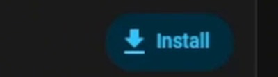
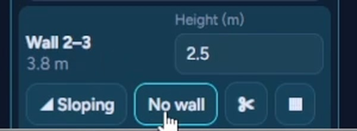
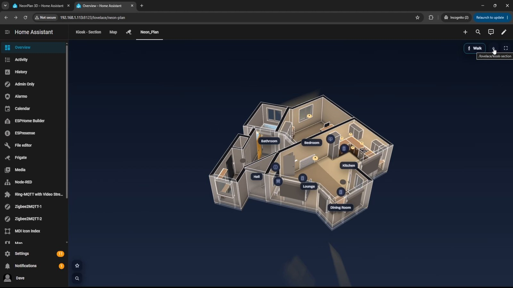

# Home Assistant 3D Floor Plan

Build an interactive 3D floor plan of your home in Home Assistant with the free version of NeonPlan 3D. This guide lists every step from the video, so you can skim it in a couple of minutes or jump to the part you need.

▶ **Watch the video:** [How to Add a 3D Floor Plan to Home Assistant (NeonPlan 3D)](https://youtu.be/JfzmJGuAmIo)

[](https://youtu.be/JfzmJGuAmIo)

*Article last updated: 17 November 2026*

## About NeonPlan 3D

NeonPlan 3D is built by Torsten (Mastershort). This guide isn't a replacement for the official manual. It covers what's in the video, and the manual covers everything else.

| | |
|---|---|
| GitHub | https://github.com/Mastershort/neonplan3d |
| Official manual | https://mastershort.de/en/neonplan3d/manual/?lang=en |
| Online demo | https://neonplan3d.mastershort.de/ |
| Support the developer | https://www.paypal.com/donate/?hosted_button_id=Z3G2VWKSK5VJL |

<!-- TOC -->
**Contents**

1. [Install NeonPlan 3D](#step-1--install-neonplan-3d)
2. [Check for updates](#step-2--check-for-updates)
3. [First launch](#step-3--first-launch)
4. [Add a floor and your 2D plan](#step-4--add-a-floor-and-your-2d-plan)
5. [Draw the rooms](#step-5--draw-the-rooms)
6. [Name the rooms and assign areas](#step-6--name-the-rooms-and-assign-areas)
7. [Add doors and windows](#step-7--add-doors-and-windows)
8. [Add devices](#step-8--add-devices)
9. [Add furniture](#step-9--add-furniture)
10. [Add it to your dashboard](#step-10--add-it-to-your-dashboard)
<!-- /TOC -->

## What you need

- Home Assistant, ideally **2026.11 or newer** (it includes the Marketplace)
- A 2D floor plan of your home (a photo is fine), or your room measurements
- *Optional:* smart devices already in Home Assistant, so you can control them from the plan

## Step 1 – Install NeonPlan 3D

▶ **Watch this step:** [Install NeonPlan 3D (2:42)](https://youtu.be/JfzmJGuAmIo?t=162)

1. Open the [installation chapter of the manual](https://mastershort.de/en/neonplan3d/manual/installation/) and click this button:

   

2. Check your Home Assistant URL, click **Save**, then **Open link**.
3. In the Marketplace, click **Install** (top right), then **Install** again:

   

4. Click **Submit** to add it to the sidebar, then **Finish**.

> [!NOTE]
> **Older than 2026.11?** You won't have the Marketplace. Install NeonPlan 3D through HACS instead. The steps are almost the same.

> [!TIP]
> **Not showing up?** Go to **Settings → Devices & services → Add integration** and search for **NeonPlan 3D**. Still missing? Restart Home Assistant and try again.

## Step 2 – Check for updates

▶ **Watch this step:** [Check for updates (5:13)](https://youtu.be/JfzmJGuAmIo?t=313)

NeonPlan 3D is updated often. Go to **Settings**, click the updates banner, update **NeonPlan 3D**, and restart Home Assistant if asked.

## Step 3 – First launch

▶ **Watch this step:** [First launch (5:46)](https://youtu.be/JfzmJGuAmIo?t=346)

Click **NeonPlan 3D** in the sidebar. A pop-up offers a free account. You only need it for the paid bundles and free seasonal packs, so click **Later**.

## Step 4 – Add a floor and your 2D plan

▶ **Watch this step:** [Add a floor and import your 2D plan (7:16)](https://youtu.be/JfzmJGuAmIo?t=436)

1. Switch from **3D** to **Editor** at the top.
2. Open the floor menu and choose **Add floor**:

   | Setting | Value |
   |---|---|
   | Name | Ground floor (the default) |
   | Elevation | 0 |
   | Ceiling height | 2.5 m |

3. Expand **Template**, click **Choose image** and pick a photo of your floor plan.
4. Click **Scale with ruler**, click two points you know the distance between, type that distance and click **Apply scale**.

> [!NOTE]
> **Other ways to start** ([6:24](https://youtu.be/JfzmJGuAmIo?t=384)): you can import a scan from an iPhone or iPad with LiDAR (a RoomPlan scan), or a Sweet Home 3D (`.sh3d`) file. See the [manual](https://mastershort.de/en/neonplan3d/manual/?lang=en). The video draws the plan by hand.

## Step 5 – Draw the rooms

▶ **Watch this step:** [Draw the rooms (9:06)](https://youtu.be/JfzmJGuAmIo?t=546)

**Draw rooms, not walls.** Rooms create the walls for you.

1. Go to **Build → Room** and choose a drawing tool:

   | Tool | Use it for |
   |---|---|
   | Rectangle | Simple square rooms |
   | Free shape | Any other shape (click each corner, finish on the starting circle) |
   | By measure | Typing exact measurements |

2. Drag corners so neighbouring rooms snap together.
3. **Open-plan rooms:** select a room, scroll down to **Wall heights**, and click **No wall** on the shared edge:

   

> [!TIP]
> **Corner won't line up?** Hold **Alt** while you drag it to place it precisely.

## Step 6 – Name the rooms and assign areas

▶ **Watch this step:** [Name the rooms and assign areas (14:21)](https://youtu.be/JfzmJGuAmIo?t=861)

Click each room and fill in:

| Field | What to enter |
|---|---|
| Name | The room name, for example Lounge |
| Further names for the voice | *Optional:* other names Home Assistant Voice can use |
| Area | The matching Home Assistant area |

## Step 7 – Add doors and windows

▶ **Watch this step:** [Add doors and windows (15:26)](https://youtu.be/JfzmJGuAmIo?t=926)

Go to **Build → Doors & windows** and click a wall. It starts as a door. Pick a different type for windows.

| Setting | What it does |
|---|---|
| Type | Door, Double window, French doors and so on |
| Swap hinge side / Reverse opening direction | Fix a door that opens the wrong way |
| Width | Set it if you know it |
| Blind | Your smart blind. NeonPlan often finds it automatically |

> [!NOTE]
> **Curtains:** the **Blind** field takes one cover. Motorised curtains can go there; the animation shows a roller blind, but it still shows open or closed. Got a blind *and* curtains on one window? Put the blind there and add the curtains as a device beside the window (Step 8). A linkable motorised curtain is now available in the paid **Architecture & Fit-out** pack.

## Step 8 – Add devices

▶ **Watch this step:** [Add devices (19:19)](https://youtu.be/JfzmJGuAmIo?t=1159)

1. Click **Select** in the toolbar first. The **Devices** panel only appears in Select mode.
2. Click a room. Devices are listed under three tabs:

   | Tab | Shows |
   |---|---|
   | This area | Devices assigned to the room's area |
   | Other areas | Devices from other areas |
   | No area | Devices without an area. Check here if one is missing |

3. Click **Place** next to a device and drag it into position. The ☆ adds it to the room panel without placing it.

## Step 9 – Add furniture

▶ **Watch this step:** [Add furniture (24:18)](https://youtu.be/JfzmJGuAmIo?t=1458)

> [!TIP]
> **Lock the floor plan first.** It's easy to drag a wall by accident, and **Undo** stops working once you switch to 3D and back. Right-click any room and choose **Lock floor plan**.

1. Click **Furniture**, then search or filter by room. Items with a 🔒 are from paid packs.
2. Click an item. It lands in the middle of the selected room. Drag it into place and hold **Alt** to fine-tune the angle.
3. **Lights** are furniture too. Link each light to its Home Assistant entity so you can tap it in 3D.
4. *Optional* ([29:04](https://youtu.be/JfzmJGuAmIo?t=1744)): search for **light switch**, place it on the wall, and link it to your switch entity.
5. Switch to **3D** ([30:25](https://youtu.be/JfzmJGuAmIo?t=1825)) and tap a light to check it works.


> [!TIP]
> **No kitchen units in the free furniture?** A table resized to fit the worktop, with small cupboards underneath, works well.

## Step 10 – Add it to your dashboard

▶ **Watch this step:** [Add it to your dashboard (31:24)](https://youtu.be/JfzmJGuAmIo?t=1884)

1. In NeonPlan, go to **Settings → Card templates** and create a template. Set the size to fill the screen and pick a style.
2. *Optional:* in the template, set **Button to a dashboard (path)** to your main dashboard (for example `/lovelace/home`). This adds a home button to the card.
3. In Home Assistant, add a new dashboard view with the **Panel (single card)** layout.
4. Add a card, search for **NeonPlan 3D** and choose your template.
5. *Optional:* on your main dashboard, add a button card with **Tap behaviour → Navigate** to the new view.

Prefer YAML? A card that uses a template only needs:

```yaml
type: custom:neonplan3d-card
template: YOUR_TEMPLATE_NAME
```



For every card option, see the [dashboard card chapter](https://mastershort.de/en/neonplan3d/manual/dashboard-card/).

## Further reading

- [Wall tablet](https://mastershort.de/en/neonplan3d/manual/wall-tablet/)
- [Backup and moving](https://mastershort.de/en/neonplan3d/manual/backup-and-moving/)
- [Manual install (no Marketplace or HACS)](https://mastershort.de/en/neonplan3d/manual/installation/)
- [Full manual](https://mastershort.de/en/neonplan3d/manual/?lang=en)
